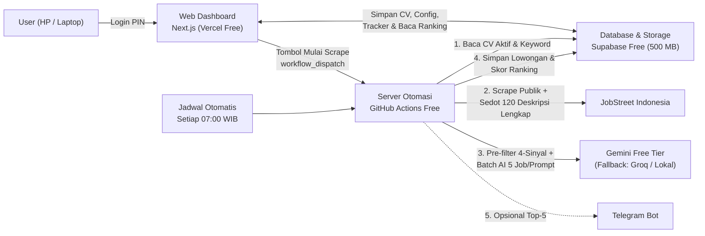

# JobStreet Auto-Matcher (100% Free Tier / Rp 0)

Aplikasi otomatisasi pencarian lowongan kerja **JobStreet Indonesia** yang berjalan penuh di server cloud (**tanpa perlu menyalakan laptop**, **tanpa login/OTP JobStreet**, dan **Rp 0 / 100% Free Tier**), dilengkapi Web Dashboard untuk mengunggah CV, mencocokkan CV dengan deskripsi lengkap lowongan, dan melacak lamaran Anda.

> **Baru pertama kali setup?** Buka langsung panduan lengkap langkah demi langkah di **[`PANDUAN_SETUP_LENGKAP.md`](./PANDUAN_SETUP_LENGKAP.md)** (estimasi setup 10–15 menit).

---

## Fitur Utama

1. **Otomasi Server Harian (Rp 0)**: Berjalan otomatis di server GitHub Actions setiap hari pukul **07:00 WIB**, atau bisa dipicu kapan saja langsung dari tombol di Web Dashboard.
2. **Scraping Cepat & Sopan (Tanpa Login / OTP)**: Mengambil data dari Search API publik JobStreet Indonesia lalu menyedot **hingga 120 deskripsi lengkap (*Responsibilities & Requirements*) per run** secara akumulatif.
3. **Matching Pintar Berbasis Deskripsi Penuh (Hybrid 4-Sinyal + Batch AI)**:
   - Menilai kecocokan dari isi deskripsi lengkap & 60+ skill teknis, Bilingual TF-IDF (Indonesia + Inggris), kecocokan judul, serta **penalti otomatis (-35 poin)** untuk profesi melenceng (misal Finance/Tax/Sales saat CV Anda Engineering).
   - **Batch AI Scoring** (5 lowongan per 1 prompt) menggunakan **Google Gemini API Free Tier** (cukup akun Gmail biasa, tidak perlu Google Pro!) dengan fallback otomatis ke **Groq Free Tier** dan **Smart Lokal**.
4. **Wizard Pembaruan Sebelum Scrape**: Sebelum server bekerja, Anda bisa memilih **CV & Research Lama** (termasuk opsi Re-match cepat), **Upload CV Baru** (PDF/DOCX hingga 25 MB), atau **Research Baru** (lengkap dengan tombol **Auto-Isi Keyword dari CV Aktif** + *Negative Keywords*).
5. **Web Dashboard Modern & Aman**:
   - Dilindungi **PIN / Password Akses** (`DASHBOARD_PASSWORD`).
   - Mendukung **Light Mode & Dark Mode**, responsif di HP dan desktop.
   - **Multi-Facet Filter** (pencarian, pengecualian judul cepat, lokasi, keyword asal, skor minimal, info gaji, pengurutan).
   - **Personal Job Tracker**: tandai lowongan sebagai **Disimpan**, **Sudah Dilamar**, atau **Diabaikan**.
   - **Lihat Deskripsi Lengkap** langsung di dashboard (dimuat *on-demand* agar sangat hemat kuota bandwidth Supabase).
   - **Notifikasi Telegram Harian (Opsional)**: ringkasan Top-5 lowongan paling cocok langsung dikirim ke HP Anda.

---

## Alur Kerja & Arsitektur Sistem



---

## Ringkasan Biaya (100% Rp 0)

| Komponen | Layanan | Kuota Gratis | Perkiraan Pemakaian |
| :--- | :--- | :--- | :--- |
| **Web Dashboard** | Vercel Hobby | Gratis untuk repo personal (termasuk Private) | Sangat ringan |
| **Database & CV Storage** | Supabase Free Tier | 500 MB DB + 1 GB Storage + 5 GB Egress/bln | ~15–30 MB untuk ribuan lowongan |
| **Server Otomasi** | GitHub Actions Free | 2.000 menit/bln (Private) / Unlimited (Public) | ~100–120 menit/bln (1× sehari) |
| **AI Scoring** | Google AI Studio (Gemini) / Groq | Free Tier (cukup akun Gmail biasa) | ~5 request per run (mode Batch) |
| **Notifikasi (Opsional)** | Telegram Bot API | Gratis tanpa batas wajar | 1 pesan/run |

---

## Struktur Folder

```text
jobstreet-auto-matcher-share/
├── README.md                         # Ringkasan project & arsitektur
├── PANDUAN_SETUP_LENGKAP.md          # Panduan setup dari 0 + daftar lengkap API Key
├── DESIGN.md                         # Spesifikasi sistem desain UI
├── .env.example                      # Template variabel environment
├── .github/workflows/
│   └── scrape-and-match.yml          # Workflow GitHub Actions (cron 07:00 WIB + trigger web)
├── supabase/
│   ├── ALL_IN_ONE_SCHEMA.sql         # 1 file SQL gabungan (cukup paste 1x di Supabase)
│   └── migrations/                   # File migrasi terpisah (referensi)
├── worker/                           # Engine Python (scraping async + hybrid matching)
└── web/                              # Aplikasi Web Next.js (deploy ke Vercel)
```

---

## Mulai Sekarang

Ikuti panduan lengkap di **[`PANDUAN_SETUP_LENGKAP.md`](./PANDUAN_SETUP_LENGKAP.md)** untuk men-deploy versi pribadi Anda sendiri dalam ~10–15 menit.
